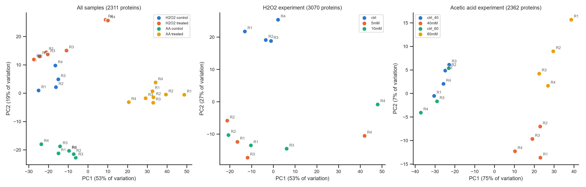
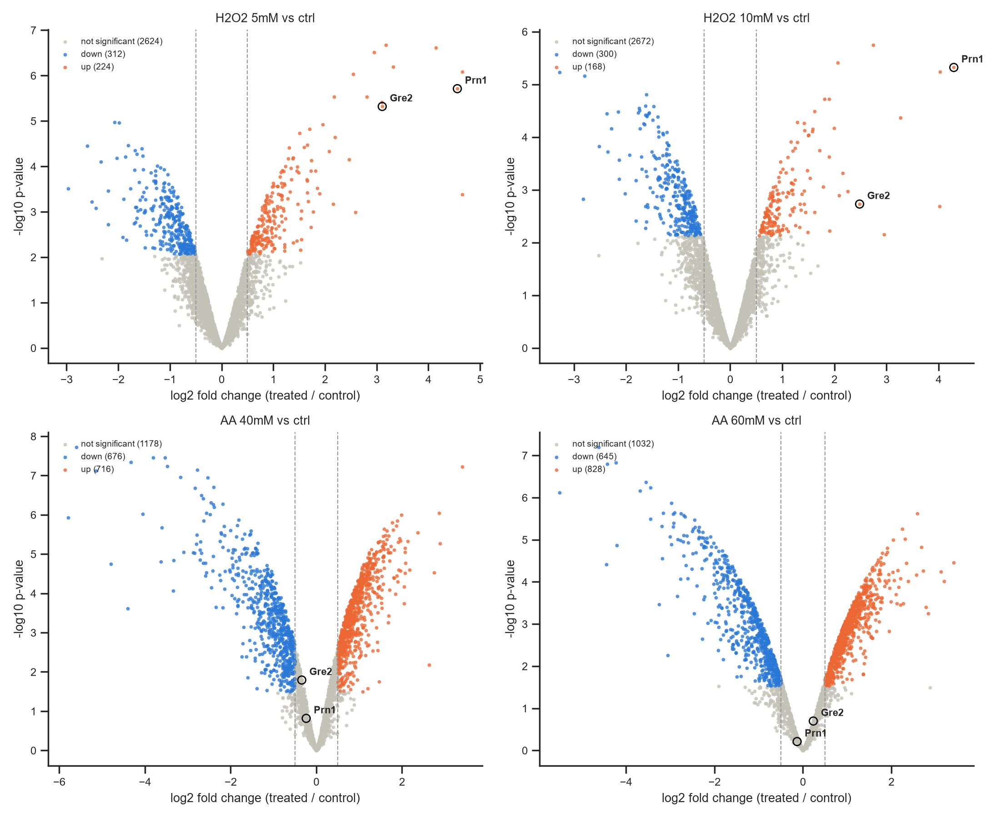
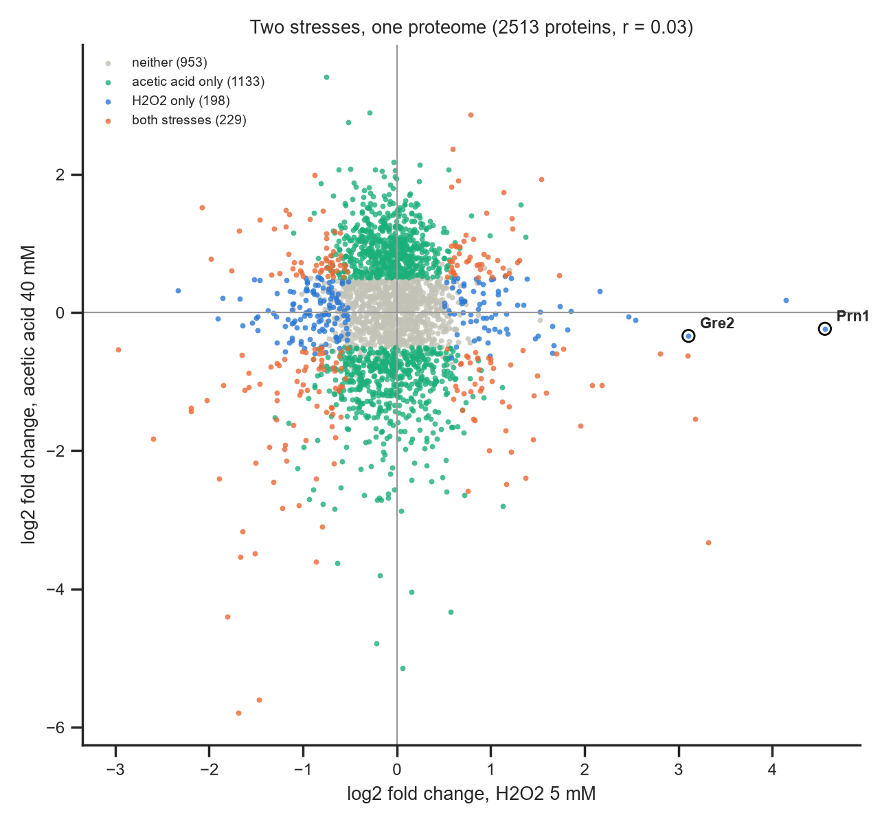

# *Candida albicans* stress proteomics — a DIA-NN reanalysis

Independent reanalysis of a public data-independent acquisition (DIA) dataset of
*Candida albicans* exposed to oxidative stress (H2O2) and weak-acid stress
(acetic acid), using library-free **DIA-NN** and a transparent Python pipeline.

**Dataset:** PRIDE [PXD020283](https://www.ebi.ac.uk/pride/archive/projects/PXD020283) ·
28 DIA runs · 120-min gradient · 400–1200 m/z, 32 variable windows

## Key results

| | |
|---|---|
| Protein groups quantified | **3,795** (1 % FDR) |
| Technical reproducibility (re-injected sample) | Pearson **r = 0.996** |
| Median CV between biological replicates | 14–29 % |
| Proteins changed by H2O2 (5 / 10 mM) | **536 / 468** (q < 0.05, \|log2FC\| > 0.5) |
| Proteins changed by acetic acid (40 / 60 mM) | **1,392 / 1,473** |
| Overlap between the two stresses | 102 proteins; fold-change correlation **r = 0.03** |

**The published positive controls are reproduced.** Both oxidative-stress markers
are strongly and significantly induced by H2O2, and unchanged by acetic acid:

| Protein | This reanalysis (log2FC) | Original paper (log2 ratio) |
|---|---|---|
| Prn1, 5 mM H2O2 | 4.56 (q = 9e-4) | 4.90 |
| Prn1, 10 mM H2O2 | 4.29 (q = 4e-3) | 5.15 |
| Gre2, 5 mM H2O2 | 3.11 (q = 1e-3) | 4.97 |
| Gre2, 10 mM H2O2 | 2.48 (q = 3e-2) | 4.60 |

Fold changes are slightly smaller than published, as expected from the different
quantification (library-free DIA-NN/MaxLFQ vs. DDA library with top-3 peptides) and
the paired design.





## Pipeline

| Step | Script | What it does |
|---|---|---|
| 1 | `src/download_raw.py` | Resumable, retrying download of the .raw files from PRIDE |
| 2 | `src/read_raw_headers.py` | Reads sample names from the .raw file headers (no SDRF was available) |
| 3 | `src/make_sample_annotation.py` | Decodes names (e.g. `5mMH2O2R1`) into experiment, dose and replicate |
| 4 | DIA-NN | Library-free search: predicted library from the *C. albicans* proteome (UniProt UP000000559) + cRAP, match-between-runs, 1 % FDR |
| 5 | `src/prepare_matrix.py` | Labels runs, log2-transforms, median-normalises |
| 6 | `src/qc.py` | Proteins per run, intensity distributions, CV, completeness, technical replicate |
| 7 | `src/pca.py` | PCA per experiment (implemented with numpy SVD) |
| 8 | `src/differential.py` | Paired moderated t-test (limma-style empirical Bayes) + Benjamini–Hochberg |
| 9 | `src/compare_stresses.py` | Core responses, shared vs specific proteins, comparison with the paper |

## Analysis decisions

- **Sample annotation from raw files.** PRIDE had no sample metadata, so sample names were
  read directly from the Thermo .raw headers and checked against the expected
  induction of Gre2 and Prn1.
- **Within-experiment comparisons only.** PCA showed that untreated controls from the two
  experiments differ (batch effect), so each treatment is compared only with its own control.
- **Median normalisation.** Before normalisation, the whole volcano cloud for acetic acid was
  shifted to log2FC ≈ −0.5, which is implausible with equal protein loading. Samples were
  median-centred on proteins quantified in every run.
- **Moderated t-test.** With only 3–4 biological replicates, an ordinary paired t-test found
  almost nothing, although ~745 proteins had p < 0.05 (~158 expected by chance). An
  empirical Bayes variance moderation (prior d0 ≈ 3.5–4.5) recovered this signal.
- **Outlier replicate kept.** Replicate 4 of the H2O2 treatments separates on PCA, but
  removing it reduced power rather than improving the results, so it was retained.
- **Missing values not imputed.** Proteins are tested only if quantified in all pairs.

## Limitations and next steps

- Proteins that disappear completely under stress are not tested (no imputation).
- One acetic-acid control (CC60R1) is missing, so 60 mM uses three pairs.
- Next: GO / pathway enrichment of the core responses; characterisation of the many
  uncharacterised proteins (`CAALFM_...`) that respond to stress.

## Reproduce

```bash
conda env create -f environment.yml
conda activate proteomics
python src/prepare_matrix.py
python src/qc.py
python src/pca.py
python src/differential.py
python src/compare_stresses.py
```
Raw files (~2 GB each) are downloaded with `src/download_raw.py`; DIA-NN settings are listed above.